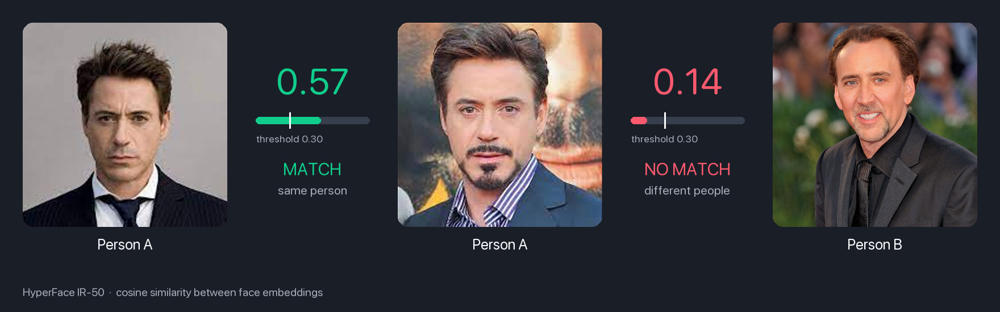

# HyperFace: Generating Synthetic Face Recognition Datasets by Exploring Face Embedding Hypersphere

[](https://github.com/yakhyo/hyperface-onnx/releases)
[](LICENSE)

ONNX Runtime inference for [HyperFace](https://www.idiap.ch/paper/hyperface/) (ICLR 2025, Idiap Research Institute), a face recognition model trained only on synthetic identities, with face detection from [UniFace](https://github.com/yakhyo/uniface).

## Models

| Model | Training data | LFW | CPLFW | CALFW | CFP | AgeDB | Size | ONNX | PyTorch |
| ----- | ------------- | --- | ----- | ----- | --- | ----- | ---- | ---- | ------- |
| IR-50 | HyperFace 50k (3.2M synthetic images) | 98.27 | 85.60 | 91.48 | 92.24 | 90.40 | 166 MB | [Link](https://github.com/yakhyo/hyperface-onnx/releases/download/weights/hyperface_ir_50.onnx) | [Link](https://github.com/yakhyo/hyperface-onnx/releases/download/weights/hyperface_ir_50.pt) |

Accuracy figures are Idiap's, from the [model card](https://huggingface.co/Idiap/HyperFace-50k-StyleGAN) of `HyperFace-50k-StyleGAN`.

### Weight port

Idiap published the model as a PyTorch training checkpoint. The weights here are ported from that file into a plain state dict, and the ONNX is exported from it:

```
Idiap .ckpt  ->  backbone state dict (.pt)  ->  onnx_export.py  ->  shipped .onnx
```

The PyTorch weights give the same output as Idiap's checkpoint, and the ONNX agrees to within 1e-6 on the embedding, checked on 96 real faces.

## Installation

```bash
pip install -r requirements.txt
bash download.sh  # Download model weights
```

Needs Python 3.11 or newer.

## Demo



## Usage

### CLI

```bash
python main.py assets/img1.jpeg assets/img2.jpeg
```

### Python API

```python
from models import FaceRecognition

fr = FaceRecognition()
similarity = fr.compare('assets/img1.jpeg', 'assets/img2.jpeg')
is_same = fr.is_match('assets/img1.jpeg', 'assets/img2.jpeg', threshold=0.3)
```

Faces are detected with UniFace's `RetinaFace`. Pass `detector=` to use another UniFace detector.

The default threshold is 0.3, which gave 98.4% accuracy on the 1,000 LFW test pairs.

## PyTorch and export

[models/backbones.py](models/backbones.py) holds the IResNet-50 as a plain `nn.Module`.

```bash
pip install torch onnx
python onnx_export.py                                           # .pt -> .onnx
python onnx_export.py --checkpoint HyperFace_50k_StyleGAN.ckpt  # start from Idiap's file
```

The network follows the [AdaFace](https://github.com/mk-minchul/AdaFace) code base the model was trained with. It differs from InsightFace's IResNet-50 in two layers, so InsightFace weights do not load into it.

## Notes

- Input is an aligned 112x112 face in BGR order, scaled to [-1, 1].
- The output is already L2-normalised.
- "Synthetic" describes the training images. The pipeline that generated them uses a pretrained face recognition model and a face generator.
- Idiap also released 10k-identity checkpoints. They export the same way.

## Reference

- [HyperFace](https://www.idiap.ch/paper/hyperface/): project page and paper, with the [training code](https://gitlab.idiap.ch/biometric/code.iclr2025_hyperface)
- [AdaFace](https://github.com/mk-minchul/AdaFace): the training code base and network definition
- [UniFace](https://github.com/yakhyo/uniface): face detection and alignment

## License

[MIT](LICENSE)
